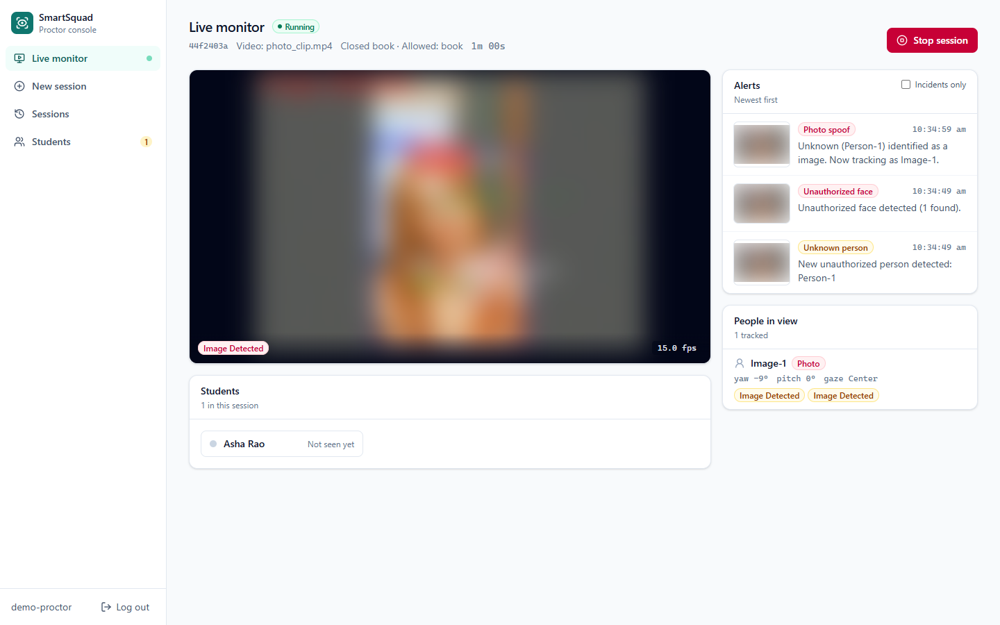
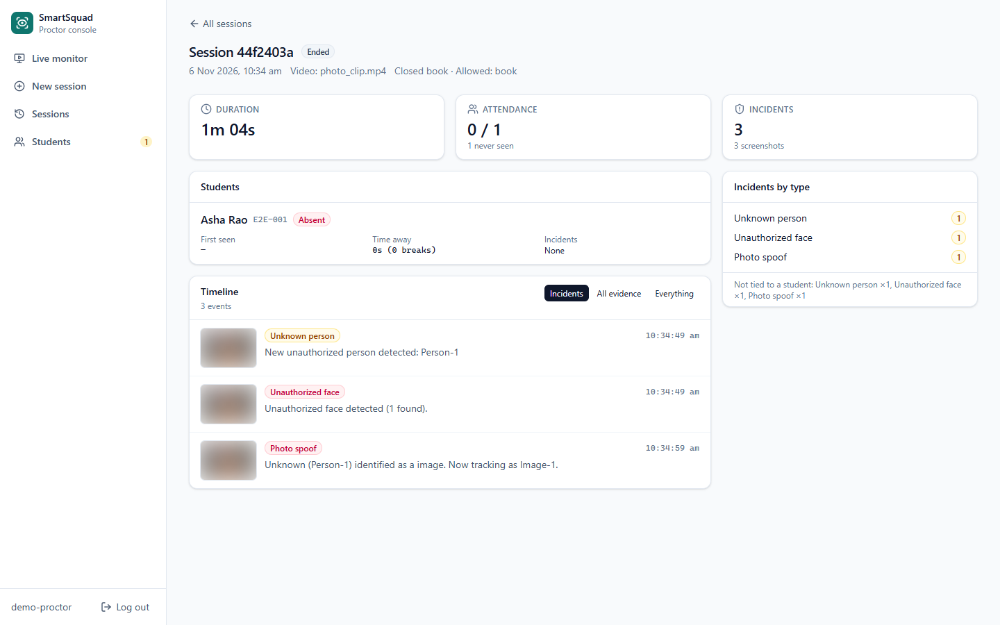
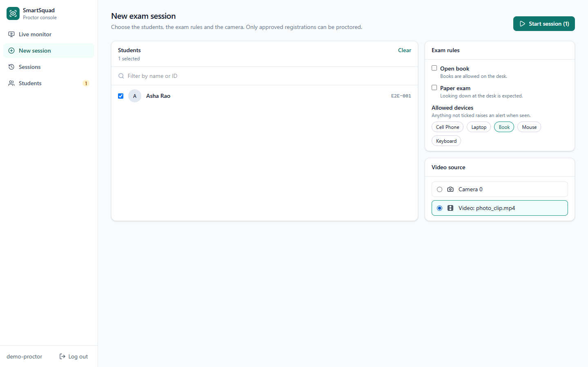
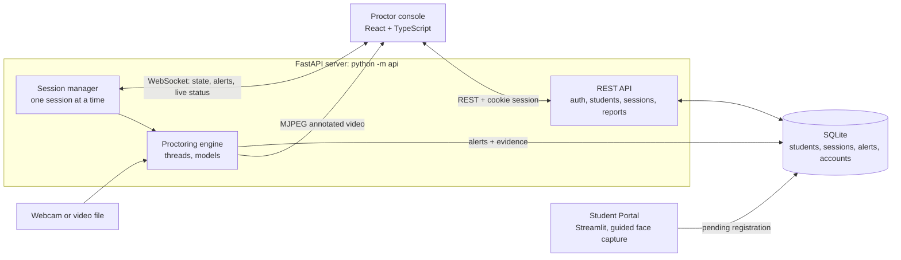
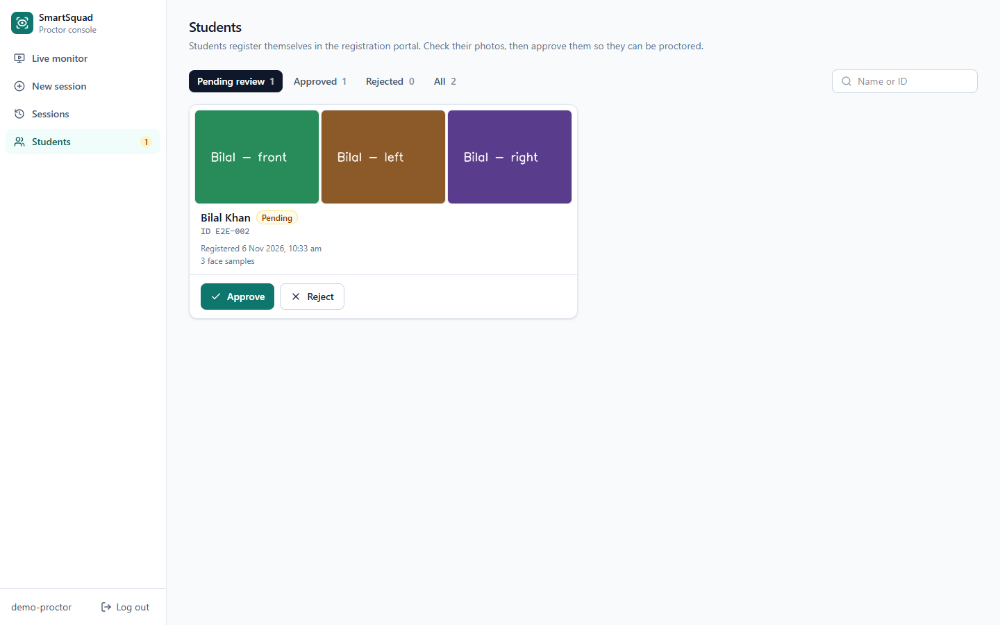

# Smart Exam Surveillance

[](https://github.com/tsetan13821/smart-exam-surveillance/actions/workflows/ci.yml)

A real-time, AI-assisted exam proctoring system. It watches a webcam feed of one or more students during an exam, checks that each person in view is a registered student, tracks where they are looking, detects unauthorized items such as phones, and records evidence snapshots of suspicious activity. Proctors run and watch exams from a web console: live annotated video, alerts as they happen, and a report for every session.

**Tech stack:** Python · FastAPI · React + TypeScript · TanStack Query · Tailwind CSS · PyTorch · OpenCV · MediaPipe · InsightFace (ArcFace) · RT-DETR (Hugging Face Transformers) · ONNX Runtime · SQLite · Streamlit (student registration) · pytest · Vitest · Playwright · Docker · GitHub Actions



| Session report | New session |
|---|---|
|  |  |

<sub>Screenshots use demo students and a test clip of a still face photo instead of a live person (flagged as a photo spoof). Faces in the video and evidence images are blurred.</sub>

---

## What it does

| Capability | How it works |
|---|---|
| **Identity verification** | InsightFace detects faces and produces 512-d ArcFace embeddings, which are matched by cosine similarity against the embeddings of the students enrolled in the session. Faces below the similarity threshold are labelled `Unknown`. |
| **Head pose and gaze** | MediaPipe FaceMesh (468 landmarks + iris, up to 4 faces) gives facial landmarks for every student in view. Head yaw/pitch is solved with OpenCV `solvePnP`, and a coarse left/centre/right gaze label comes from the nose position relative to the eyes. Eye and mouth aspect ratios (EAR/MAR) give blink and mouth-open state. |
| **Contraband detection** | RT-DETR (`PekingU/rtdetr_r50vd`, COCO classes) detects people, phones, laptops, books, keyboards and mice. Each item is assigned to the student whose desk region contains it (from `calibrate_rois.py`). Without regions, it goes to the only person in view, or with several people to the nearest face within four face heights, so a phone held low in the lap still counts. An item must be seen for 2 s before it counts, so one-frame misdetections are ignored. |
| **Liveness / anti-spoofing** | Each face has to prove it is live by blinking. A blink is a dip in EAR well below that person's own rolling open-eye level, followed by recovery; the required dip scales with how noisy that face's landmarks are. A new face that hasn't blinked within 8 s, or a confirmed face that hasn't blinked for 30 s, is treated as a photo. Head movement and pixel motion are deliberately not used as proof of life, because a photo on a moving phone produces both. |
| **Context-aware rules** | The proctor sets the exam context at launch: open-book exams allow books, paper-based exams allow looking down at the desk, and specific devices can be allowed. Alerts take this context into account. |
| **Live monitoring and review** | The proctor console streams the annotated video and pushes alerts to the browser as they happen. Every alert saves a screenshot and a database record; each session gets a report with attendance, breaks and incidents per student, with the evidence images. |

---

## How it works

The proctoring engine runs inside a FastAPI server, which the proctor console (a React app) talks to. Students register through a separate Streamlit portal.



### 1. Student registration
Students open the **Student Portal**, enter their ID and name, and complete a guided webcam capture. The page estimates head yaw in real time and asks them to face **front**, **left** and **right**. Each pose must be held for 15 consecutive frames before it is captured. An ArcFace embedding is computed for each pose, and the registration is saved with status `pending`, along with the three photos for review.

### 2. Approval
On the console's **Students** page, a proctor sees the three captured photos next to the entered name and ID, and approves or rejects the registration. The reviewer and time are recorded. Only approved students can be selected for an exam.



### 3. Starting a session
On **New session**, the proctor selects the students sitting the exam, sets whether it is open-book and paper-based, ticks any allowed devices, and picks the video source (the webcam, or a recorded video for demos and testing). The server loads the models in the background and the console switches to the **Live monitor**, which shows the annotated video, who is at their desk, each person's liveness and head pose, and alerts with their evidence as they arrive. There is one camera, so one session runs at a time; a second start is refused until the first one is stopped.

### 4. The real-time engine
The engine uses three threads so that heavy model inference never holds up the per-frame analysis:

- **Capture thread:** reads webcam frames and pushes them into a 2-slot queue, dropping frames when the worker is busy so the queue never builds up stale frames. It also displays the latest annotated frame.
- **Inference thread:** runs the two heavy models on the newest frame, as often as the hardware allows (at most every 0.2 s), and publishes their latest results.
- **Processing thread:** runs the per-frame pipeline below on every frame, using the latest heavy-model results.

```
inference thread (newest frame)          processing thread (every frame)
 ├─ RT-DETR object detection              ├─ MediaPipe FaceMesh → head pose, gaze, EAR/MAR (up to 4 faces)
 └─ InsightFace detect + identify  ───▶   ├─ Person tracker: links face boxes to landmarks, keeps stable IDs
                                          ├─ Per-person analysis: liveness, gaze-away timer, devices, pose alerts
                                          ├─ Session analysis: presence/absence, unauthorized faces, alert priority
                                          └─ Overlay, then evidence screenshots of the annotated frame
```

Liveness depends on catching blinks that last 100–400 ms, so MediaPipe has to see every frame, not only the frames the heavy models have time for. On CPU, each heavy model is limited to a quarter of the cores (`CPU_HEAVY_MODEL_THREADS`) so they share the processor with the per-frame thread instead of starving it. Setting `HEAVY_MODELS_ASYNC = False` in `config.py` switches back to a single thread with the heavy models on every 5th frame.

### 5. Alerts
Alerts are evaluated per person and for the whole session. The status bar shows the highest-priority active alert.

| Alert | Trigger (defaults in `config.py`) |
|---|---|
| Image Detected | A new face hasn't blinked within 8 s, or a confirmed face hasn't blinked for 30 s; raised once this has lasted 2 s. A face the system can't see clearly is not judged. A face flagged as a photo doesn't count as the student being present. |
| Suspicious Activity (Device + Gaze) | A non-allowed device is assigned to the student **and** they look away (yaw > 25°, or pitch beyond 20°) for 3 s |
| Contraband Detected | A non-allowed device has been seen at the student's desk for at least 2 s |
| Sustained Gaze Away | The student looks away for 5 s with no device involved. In paper-based exams, looking down doesn't count. |
| Unauthorized Face | A face that doesn't match any enrolled student, for 3 s |
| Student Missing | An enrolled student who was present hasn't been seen for 10 s, or never arrived within the first 60 s of the session |
| Peeking Alert | Head turned more than 25° to the side for 5 s |
| Excessive Movement | More than 20 head turns within 60 s, where a turn is the head moving more than 20° away from the student's own usual position (counted once, until the head comes back). Small shifts while reading or writing don't count. |

Each incident saves one evidence screenshot, not one per frame.

Attendance events (`ATTENDANCE_MARKED`, `PRESENCE_LEFT`, `PRESENCE_RETURNED`) are also recorded and used to build the break report.

### 6. Logging and review
- **SQLite** (`proctoring_session.db`, WAL mode): students and their face embeddings, proctor accounts and login sessions, a `sessions` table (students, exam rules, video source, start/end time, status) and an `alerts` table (timestamp, level, alert type, the student it concerns, message, evidence file).
- **Evidence screenshots** are saved in `proctoring_logs/evidence/` and served to logged-in proctors only.
- **Detailed debug logs** (liveness decisions, similarity scores, detections, human actions) are written per session under `logs/`. Logging runs on its own background thread so disk I/O never blocks the video pipeline.

The **Sessions** page lists every exam. A session's report shows its duration, attendance, each student's first appearance, breaks and time away, incidents by type and student, and a timeline of every event with its evidence image.

### 7. Web API and security
- **Proctor login:** passwords are hashed with scrypt. A login creates a random session token, which is kept in an `httpOnly`, `SameSite=Strict` cookie and stored server-side only as a SHA-256 hash, so logins can be revoked and a leaked database can't be used to sign in. Repeated failed logins lock that username for a minute.
- **Cross-site protection:** state-changing requests and the WebSocket must come from the console's own origin, and responses carry a Content-Security-Policy and other security headers.
- **Server binding:** the server listens on `127.0.0.1` by default, and runs a single worker because the camera and the running session belong to one process.
- **Live data:** the annotated video is an MJPEG stream (an `` in the browser). Session state, alerts and live status (about twice a second) go over one WebSocket per browser tab, which reconnects with backoff.
- **Interrupted sessions:** a session cut off by a crash or restart is marked `failed` when the server starts.
- **API docs:** interactive documentation is served at `/docs`.

---

## Project structure

```
├── api/                        # FastAPI server (python -m api)
│   ├── main.py                 # App factory, security middleware, frontend serving
│   ├── routes/                 # auth, students, sessions (+ MJPEG stream, evidence), live WebSocket
│   ├── auth_store.py, security.py  # Accounts, scrypt hashing, session tokens, login throttling
│   ├── events.py               # Engine threads -> WebSocket clients
│   ├── session_store.py, reports.py  # Session history and per-student reports
│   └── manage.py               # create-user / set-password
├── frontend/                   # React + TypeScript proctor console (Vite, TanStack Query, Tailwind)
│   ├── src/pages/              # Login, Live monitor, New session, Sessions, Session report, Students
│   └── e2e/                    # Playwright tests against the real server
├── main.py                     # Run one session in an OpenCV window from the command line
├── config.py                   # All tunable thresholds, model settings and data locations
├── calibrate_rois.py           # Tool to draw per-student desk regions on the camera view
├── register_student.py         # CLI alternative to enroll a student from a photo
├── app/
│   ├── core.py                 # ProctoringApp: capture, inference and processing threads
│   ├── session_manager.py      # Runs sessions in the background for the API
│   ├── session_setup.py        # Validates students, loads face data and desk regions
│   ├── video_source.py         # Webcam or video file
│   ├── models/tracked_person.py
│   ├── processors/
│   │   ├── face_recognizer.py      # InsightFace / ArcFace identification
│   │   ├── face_processor.py       # Interval-based face detection state
│   │   ├── object_detector.py      # RT-DETR detection
│   │   ├── mediapipe_processor.py  # FaceMesh, solvePnP head pose, gaze, EAR/MAR (multi-face)
│   │   ├── person_tracker.py       # Centroid tracker with persistent IDs
│   │   ├── liveness_detector.py    # Adaptive blink-based liveness
│   │   ├── person_analyzer.py      # Per-person liveness + pose alerts
│   │   ├── cheating_detector.py    # Context-aware rule engine
│   │   └── proctoring_analyzer.py  # Session-level analysis and alert priority
│   └── utils/                  # SQLite (sessions, students), async logger, drawing
├── student_registration/       # Streamlit student portal + guided registration page
├── scripts/                    # insightface install without build tools, CI/Docker dependency install
├── tests/                      # Engine rules on a simulated clock, data layer, session manager, web API
├── benchmarks/                 # Liveness and throughput benchmarks, clip recorder, saved results
├── docs/screenshots/
├── .github/workflows/ci.yml    # Lint, tests, build and browser tests on every push and pull request
├── Dockerfile, docker-compose.yml  # CPU demo image: API + console proctoring recorded videos
└── pyproject.toml              # ruff and pytest settings
```

---

## Getting started

### Requirements
- Python 3.10 or 3.11, and Node.js 20 or newer (to build the console)
- A webcam, or a recorded video to proctor
- An NVIDIA GPU is recommended. On CPU every camera frame is still analysed, but detections and identities refresh only about once per second (see [Measured results](#measured-results)).

### Install
Commands are for Windows PowerShell; on macOS/Linux use `.venv/bin/python` and `/` in paths.

```powershell
git clone https://github.com/tsetan13821/smart-exam-surveillance.git
cd smart-exam-surveillance
python -m venv .venv
.\.venv\Scripts\python.exe -m pip install -r requirements.txt
```

The code uses MediaPipe's FaceMesh *solutions* API, which newer MediaPipe releases have removed, so `requirements.txt` pins `mediapipe==0.10.21` (with `numpy==1.26.4` and `opencv-python==4.11.0.86`). Use a virtual environment: these pins conflict with packages that need NumPy 2. For GPU inference, install the CUDA build of PyTorch from pytorch.org. On first run, the InsightFace `buffalo_l` and RT-DETR model weights are downloaded automatically.

**Windows without the C++ Build Tools:** `pip install insightface` compiles a C extension and fails without the Microsoft C++ Build Tools. Either install them, or install everything else and then only insightface's Python code (the compiled part renders face masks, which this project doesn't use):

```powershell
Get-Content requirements.txt | Where-Object { $_ -notmatch '^insightface' } | Set-Content requirements-noinsightface.txt
.\.venv\Scripts\python.exe -m pip install -r requirements-noinsightface.txt onnx scikit-image easydict
.\.venv\Scripts\python.exe scripts\install_insightface_nobuild.py
```

Then create a proctor account and build the console:

```powershell
.\.venv\Scripts\python.exe -m api.manage create-user yourname    # asks for a password (8+ characters)
cd frontend
npm install
npm run build
cd ..
```

### Run
```powershell
# Proctor console and API, at http://127.0.0.1:8000
.\.venv\Scripts\python.exe -m api

# Student registration portal (from the student_registration folder)
cd student_registration
..\.venv\Scripts\python.exe -m streamlit run student_portal.py
```

To proctor a recorded video instead of the webcam (for demos or testing), put `.mp4` files in a `demo_videos/` folder; they appear as video sources on the **New session** page.

For frontend development with hot reload, keep the API running and start Vite in `frontend/` with `npm run dev`, then open http://localhost:5173. Vite forwards `/api` (including the WebSocket) to the API.

A session can also be run without the web console, in an OpenCV window (press `q` to end it):

```powershell
.\.venv\Scripts\python.exe main.py --student_ids '["1001"]' --exam_context '{"is_paper_exam": true}'
.\.venv\Scripts\python.exe main.py --student_ids '["1001"]' --source demo_videos\exam.mp4
```

### Docker demo
The image runs the API and console on CPU with the model weights built in, so nothing else needs installing. A container can't reach the host's webcam on Windows or macOS, so in Docker the console proctors recorded videos only.

```powershell
Copy-Item .env.example .env          # then set SMARTSQUAD_ADMIN_PASSWORD and TZ (your timezone) in .env
New-Item -ItemType Directory -Force demo_videos
# copy one or more .mp4 recordings into demo_videos
docker compose up --build            # first build downloads about 2 GB; then open http://localhost:8000
```

Sign in with the user and password from `.env`. To enrol a student from a photo (approved straight away), put the photo in a `photos` folder and run the command-line registration inside the container; enter `/photos/` followed by the file name when it asks for the photo:

```powershell
docker compose run --rm -v ${PWD}/photos:/photos:ro smartsquad python register_student.py
```

The database, registrations and evidence live in the `smartsquad-data` volume, so they survive restarts; `docker compose down -v` deletes them. The port is published on `127.0.0.1` only.

### Tests and benchmarks
Every push and pull request runs the checks below on GitHub Actions ([`ci.yml`](.github/workflows/ci.yml)): ruff, pytest, the frontend lint, type check, unit tests and build, then the end-to-end browser tests against the real server and models.

```powershell
.\.venv\Scripts\python.exe -m pytest tests      # engine rules, liveness, data layer, session manager, web API (no models needed)
.\.venv\Scripts\python.exe -m ruff check .      # lint (pip install ruff; settings in pyproject.toml)

cd frontend
npm test                                         # component and state tests (Vitest)
npm run lint
npm run typecheck

# End-to-end: a browser drives the built console against the real server and models
$env:SMARTSQUAD_PYTHON = "..\.venv\Scripts\python.exe"
$env:E2E_VIDEO_DIR = "C:\path\to\folder-with-a-video"
$env:E2E_BROWSER = "msedge"                      # or first run: npx playwright install chromium
npm run e2e
cd ..

# Liveness: synthetic photo-attack clips built from face photos, plus any recordings you add
.\.venv\Scripts\python.exe benchmarks\record_clip.py live reading_notes
.\.venv\Scripts\python.exe benchmarks\liveness_benchmark.py --images path\to\face_photos --clips benchmarks\clips

# Throughput of the full pipeline on this machine
.\.venv\Scripts\python.exe benchmarks\perf_benchmark.py --source path\to\frame_or_video
```

The end-to-end tests use their own temporary database and folders, never your real data.

### Configuration
All thresholds live in [`config.py`](config.py), including:
- camera index
- face-similarity threshold
- detection interval and confidence
- head-pose and gaze limits
- liveness timings
- alert durations

Data locations can be changed with environment variables: `SMARTSQUAD_DB`, `SMARTSQUAD_REGISTRATIONS_DIR`, `SMARTSQUAD_LOG_DIR` and `SMARTSQUAD_DEMO_VIDEOS`. When the console is served over HTTPS, set `SMARTSQUAD_COOKIE_SECURE=1`. `SMARTSQUAD_DISABLE_CAMERA=1` hides the webcam source (the Docker image sets it). `SMARTSQUAD_ADMIN_USER` and `SMARTSQUAD_ADMIN_PASSWORD` create the first proctor account when the database has none.

---

## Measured results

Measured on a 16-thread laptop CPU with no GPU. Methods, breakdowns and raw results are in [PROJECT_DOCUMENTATION.md](PROJECT_DOCUMENTATION.md#7-evaluation) and `benchmarks/results/`.

| | First version | Current |
|---|---|---|
| Photo-attack clips detected (126 synthetic clips: still, shaken and tilted, 3 noise levels, 2 face sizes) | 0% | 100% (alert after ~10 s) |
| Camera frames analysed per second (30 FPS webcam) | 2.2 | 30 |
| Longest gap between analysed frames (blinks shorter than this can be missed) | 2.5 s | 52 ms |
| Detection / identity refreshes per second | 0.44 | 0.87 |

Not measured yet: how often real students are wrongly flagged as photos (this needs real recordings; see `benchmarks/record_clip.py`), and GPU performance.

---

## Data and privacy

The system stores biometric data: face embeddings in the SQLite database (older installs kept them in `student_encodings.json`, which is imported once and then left untouched) and registration photos in `registrations_for_review/`. It also stores session evidence screenshots, which the API serves only to logged-in proctors. All of these, along with logs, demo videos and benchmark recordings, are excluded from version control by `.gitignore`. Keep them locally and handle them according to your institution's data-protection rules.

---

## Known limitations

- **False-alarm rate on real students is unmeasured.** A student who doesn't blink for more than 30 s would be flagged as a photo.
- **Video replays.** A video of the student blinking passes the blink check. Catching replays needs a texture- or depth-based anti-spoofing model.
- **Device classes.** The detector uses COCO classes, so earphones, calculators, smartwatches and tablets can't be detected without a custom-trained model.
- **Gaze** comes from head pose, plus a coarse label from the nose position relative to the eyes. Eye-only glances with a still head aren't tracked.
- **One camera per session**, with up to 4 faces analysed.

---

## Author

**Tenzin Tsetan**, [GitHub @tsetan13821](https://github.com/tsetan13821)
