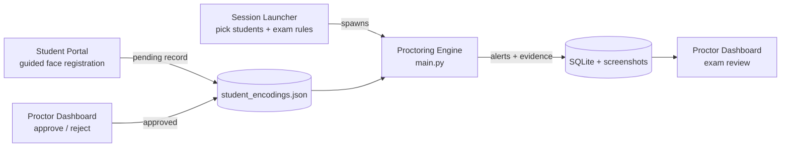

# Smart Exam Surveillance

A real-time, AI-assisted exam proctoring system. It watches a webcam feed of one or more students during an exam, checks that each person in view is a registered student, tracks where they are looking, detects unauthorized items such as phones, and records evidence snapshots of suspicious activity for a proctor to review during or after the exam.

**Tech stack:** Python · PyTorch · OpenCV · MediaPipe · InsightFace (ArcFace) · RT-DETR (Hugging Face Transformers) · ONNX Runtime · Streamlit · SQLite

---

## What it does

| Capability | How it works |
|---|---|
| **Identity verification** | InsightFace detects faces and produces 512-d ArcFace embeddings, which are matched by cosine similarity against the embeddings of the students enrolled in the session. Faces below the similarity threshold are labelled `Unknown`. |
| **Head pose and gaze** | MediaPipe FaceMesh (468 landmarks + iris, up to 4 faces) gives facial landmarks for every student in view. Head yaw/pitch is solved with OpenCV `solvePnP`, and a coarse left/centre/right gaze label comes from the nose position relative to the eyes. Eye and mouth aspect ratios (EAR/MAR) give blink and mouth-open state. |
| **Contraband detection** | RT-DETR (`PekingU/rtdetr_r50vd`, COCO classes) detects people, phones, laptops, books, keyboards and mice. Each item is assigned to the student whose desk region contains it (from `calibrate_rois.py`), or to the nearest student if no regions are set. An item must be seen for 2 s before it counts, so one-frame misdetections are ignored. |
| **Liveness / anti-spoofing** | Each face has to prove it is live by blinking. A blink is a dip in EAR well below that person's own rolling open-eye level, followed by recovery; the required dip scales with how noisy that face's landmarks are. A new face that hasn't blinked within 8 s, or a confirmed face that hasn't blinked for 30 s, is treated as a photo. Head movement and pixel motion are deliberately not used as proof of life, because a photo on a moving phone produces both. |
| **Context-aware rules** | The proctor sets the exam context at launch: open-book exams allow books, paper-based exams allow looking down at the desk, and specific devices can be allowed. Alerts take this context into account. |
| **Evidence and review** | Every alert saves a screenshot and a database record. A Streamlit dashboard shows each session's incidents with their evidence images, an attendance and break report, and a live-refresh mode. |

---

## How it works

The system is made up of three Streamlit apps and one real-time engine:



### 1. Student registration
Students open the **Student Portal**, enter their ID and name, and complete a guided webcam capture. The page estimates head yaw in real time and asks them to face **front**, **left** and **right**. Each pose must be held for 15 consecutive frames before it is captured. An ArcFace embedding is computed for each pose, and the record is saved with status `pending`, along with the three photos for review.

### 2. Approval
In the **Proctor Dashboard → Registration Approval** page, an administrator sees the three captured photos next to the entered name and approves or rejects the registration. Only approved students can be selected for an exam.

### 3. Launching a session
The **Session Launcher** lists approved students. The proctor selects who is sitting the exam, sets whether it is open-book and whether it is paper-based, and picks any allowed devices. It then starts the proctoring engine as a separate process, passing the student IDs and exam context as arguments.

### 4. The real-time engine
The engine uses three threads so that heavy model inference never holds up the per-frame analysis:

- **Capture thread:** reads webcam frames and pushes them into a 2-slot queue, dropping frames when the worker is busy so the queue never builds up stale frames. It also displays the latest annotated frame.
- **Inference thread:** runs the two heavy models on the newest frame, as often as the hardware allows (at most every 0.2 s), and publishes their latest results.
- **Processing thread:** runs the per-frame pipeline below on every frame, using the latest heavy-model results.

```
inference thread (newest frame)          processing thread (every frame)
 ├─ RT-DETR object detection              ├─ MediaPipe FaceMesh → head pose, gaze, EAR/MAR (up to 4 faces)
 └─ InsightFace detect + identify  ───▶   ├─ Person tracker: links face boxes to landmarks, keeps stable IDs
                                          ├─ Per-person analysis: liveness, gaze-away timer, devices, pose alerts
                                          ├─ Session analysis: presence/absence, unauthorized faces, alert priority
                                          └─ Overlay, then evidence screenshots of the annotated frame
```

Liveness depends on catching blinks that last 100–400 ms, so MediaPipe has to see every frame, not only the frames the heavy models have time for. On CPU, each heavy model is limited to a quarter of the cores (`CPU_HEAVY_MODEL_THREADS`) so they share the processor with the per-frame thread instead of starving it. Setting `HEAVY_MODELS_ASYNC = False` in `config.py` switches back to a single thread with the heavy models on every 5th frame.

### 5. Alerts
Alerts are evaluated per person and for the whole session. The status bar shows the highest-priority active alert.

| Alert | Trigger (defaults in `config.py`) |
|---|---|
| Image Detected | A new face hasn't blinked within 8 s, or a confirmed face hasn't blinked for 30 s; raised once this has lasted 2 s. A face the system can't see clearly is not judged. A face flagged as a photo doesn't count as the student being present. |
| Suspicious Activity (Device + Gaze) | A non-allowed device is assigned to the student **and** they look away (yaw > 25°, or pitch beyond 20°) for 3 s |
| Contraband Detected | A non-allowed device has been seen at the student's desk for at least 2 s |
| Sustained Gaze Away | The student looks away for 5 s with no device involved. In paper-based exams, looking down doesn't count. |
| Unauthorized Face | A face that doesn't match any enrolled student, for 3 s |
| Student Missing | An enrolled student who was present hasn't been seen for 10 s, or never arrived within the first 60 s of the session |
| Peeking Alert | Head turned more than 25° to the side for 5 s |
| Excessive Movement | More than 20 large head movements within 60 s |

Each incident saves one evidence screenshot, not one per frame.

Attendance events (`ATTENDANCE_MARKED`, `PRESENCE_LEFT`, `PRESENCE_RETURNED`) are also recorded and used to build the break report.

### 6. Logging and review
- **SQLite** (`proctoring_session.db`): a `sessions` table (session ID, students, start time) and an `alerts` table (timestamp, level, alert type, message, evidence file path).
- **Evidence screenshots** are saved in `proctoring_logs/evidence/`.
- **Detailed debug logs** (liveness decisions, similarity scores, detections, human actions) are written per session under `logs/`. Logging runs on its own background thread so disk I/O never blocks the video pipeline.

The **Exam Review** page reads the database and shows, for each session, the participants, an attendance and break timeline, and a chronological incident report with the evidence image for each alert. Live mode follows the most recent session and refreshes every 10 seconds.

---

## Project structure

```
├── main.py                     # Proctoring engine entry point (spawned by the launcher)
├── launcher.py                 # Streamlit: select approved students + exam rules, start a session
├── config.py                   # All tunable thresholds and model settings
├── calibrate_rois.py           # Tool to draw per-student desk regions on the camera view
├── register_student.py         # CLI alternative to enroll a student from a photo
├── app/
│   ├── core.py                 # ProctoringApp: capture thread, processing thread, pipeline
│   ├── models/tracked_person.py
│   ├── processors/
│   │   ├── face_recognizer.py      # InsightFace / ArcFace identification
│   │   ├── face_processor.py       # Interval-based face detection state
│   │   ├── object_detector.py      # RT-DETR detection
│   │   ├── mediapipe_processor.py  # FaceMesh, solvePnP head pose, gaze, EAR/MAR (multi-face)
│   │   ├── person_tracker.py       # Centroid tracker with persistent IDs
│   │   ├── liveness_detector.py    # Adaptive blink-based liveness
│   │   ├── person_analyzer.py      # Per-person liveness + pose alerts
│   │   ├── cheating_detector.py    # Context-aware rule engine
│   │   └── proctoring_analyzer.py  # Session-level analysis and alert priority
│   └── utils/                  # SQLite, async logger, drawing, student registry
├── student_registration/       # Streamlit student portal + guided registration page
├── review/                     # Streamlit proctor dashboard: exam review + registration approval
├── tests/                      # Model-free tests of rules, liveness, tracker and logger on a simulated clock
└── benchmarks/                 # Liveness and throughput benchmarks, clip recorder, saved results
```

---

## Getting started

### Requirements
- Python 3.10 or 3.11
- A webcam
- An NVIDIA GPU is recommended. On CPU every camera frame is still analysed, but detections and identities refresh only about once per second (see [Measured results](#measured-results)).
- On Windows, installing `insightface` requires the Microsoft C++ Build Tools.

### Install
```bash
git clone https://github.com/tsetan13821/smart-exam-surveillance.git
cd smart-exam-surveillance
python -m venv venv
venv\Scripts\activate            # Windows  (macOS/Linux: source venv/bin/activate)
pip install -r requirements.txt
```

The code uses MediaPipe's FaceMesh *solutions* API, which newer MediaPipe releases have removed, so `requirements.txt` pins `mediapipe==0.10.21` (with `numpy==1.26.4` and `opencv-python==4.11.0.86`). For GPU inference, install the CUDA build of PyTorch from pytorch.org. On first run, the InsightFace `buffalo_l` and RT-DETR model weights are downloaded automatically.

### Run
```bash
# 1. Students register (run from the student_registration folder)
cd student_registration
streamlit run student_portal.py

# 2. Proctor approves registrations and reviews exams (run from the review folder)
cd review
streamlit run dashboard.py

# 3. Proctor starts an exam session (run from the project root)
streamlit run launcher.py
```

The proctoring window opens on the machine with the camera. Press `q` to end the session. The engine can also be started directly:

```bash
python main.py --student_ids "[\"1001\"]" --exam_context "{\"is_open_book\": false, \"allowed_devices\": []}"
```

### Tests and benchmarks
```bash
pytest tests                                   # rules, liveness, tracker, logger (no models needed)

# Liveness: synthetic photo-attack clips built from face photos, plus any recordings you add
python benchmarks/record_clip.py live reading_notes   # saves benchmarks/clips/live/reading_notes.mp4
python benchmarks/liveness_benchmark.py --images path/to/face_photos --clips benchmarks/clips

# Throughput of the full pipeline on this machine
python benchmarks/perf_benchmark.py --source path/to/frame_or_video
```

### Configuration
All thresholds live in [`config.py`](config.py), including:
- camera index
- face-similarity threshold
- detection interval and confidence
- head-pose and gaze limits
- liveness timings
- alert durations

---

## Measured results

Measured on a 16-thread laptop CPU with no GPU. Methods, breakdowns and raw results are in [PROJECT_DOCUMENTATION.md](PROJECT_DOCUMENTATION.md#7-evaluation) and `benchmarks/results/`.

| | First version | Current |
|---|---|---|
| Photo-attack clips detected (126 synthetic clips: still, shaken and tilted, 3 noise levels, 2 face sizes) | 0% | 100% (alert after ~10 s) |
| Camera frames analysed per second (30 FPS webcam) | 2.2 | 30 |
| Longest gap between analysed frames (blinks shorter than this can be missed) | 2.5 s | 52 ms |
| Detection / identity refreshes per second | 0.44 | 0.87 |

Not measured yet: how often real students are wrongly flagged as photos (this needs real recordings; see `benchmarks/record_clip.py`), and GPU performance.

---

## Data and privacy

The system stores biometric data: face embeddings in `student_encodings.json` and registration photos in `registrations_for_review/`. It also stores session evidence screenshots. All of these, along with the session database, logs and benchmark recordings, are excluded from version control by `.gitignore`. Keep them locally and handle them according to your institution's data-protection rules.

---

## Known limitations

- **False-alarm rate on real students is unmeasured.** A student who doesn't blink for more than 30 s would be flagged as a photo.
- **Video replays.** A video of the student blinking passes the blink check. Catching replays needs a texture- or depth-based anti-spoofing model.
- **Device classes.** The detector uses COCO classes, so earphones, calculators, smartwatches and tablets can't be detected without a custom-trained model.
- **Gaze** comes from head pose, plus a coarse label from the nose position relative to the eyes. Eye-only glances with a still head aren't tracked.
- **One camera per session**, with up to 4 faces analysed.

---

## Author

**Tenzin Tsetan**, [GitHub @tsetan13821](https://github.com/tsetan13821)
