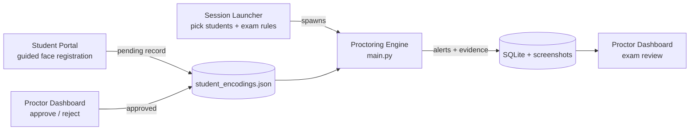

# Smart Exam Surveillance

A real-time, AI-assisted exam proctoring system. It watches a webcam feed of one or more students during an exam, checks that each person in view is a registered student, tracks where they are looking, detects unauthorized items such as phones, and records evidence snapshots of suspicious activity for a proctor to review during or after the exam.

**Tech stack:** Python · PyTorch · OpenCV · MediaPipe · InsightFace (ArcFace) · RT-DETR (Hugging Face Transformers) · ONNX Runtime · Streamlit · SQLite

---

## What it does

| Capability | How it works |
|---|---|
| **Identity verification** | InsightFace detects faces and produces 512-d ArcFace embeddings, which are matched by cosine similarity against the embeddings of the students enrolled in the session. Faces below the similarity threshold are labelled `Unknown`. |
| **Head pose and gaze** | MediaPipe FaceMesh (468 landmarks + iris) gives facial landmarks; head yaw/pitch is solved with OpenCV `solvePnP`, and the iris position gives a gaze direction. Eye and mouth aspect ratios (EAR/MAR) give blink and mouth-open state. |
| **Contraband detection** | RT-DETR (`PekingU/rtdetr_r50vd`, COCO classes) detects people, phones, books, keyboards and mice. Each item is assigned to the nearest student. |
| **Liveness / anti-spoofing** | A per-person state machine looks for signs of life (blinks, head movement, gaze shifts, optical-flow motion) and treats a face that shows none of them for a set time, or whose image stays nearly unchanged (SSIM), as a photo. |
| **Context-aware rules** | The proctor sets the exam context at launch: open-book exams allow books, and specific devices can be allowed. Alerts take this context into account. |
| **Evidence and review** | Every alert saves a screenshot and a database record. A Streamlit dashboard shows each session's incidents with their evidence images, an attendance and break report, and a live-refresh mode. |

---

## How it works

The system is made up of three Streamlit apps and one real-time engine:



### 1. Student registration
Students open the **Student Portal**, enter their ID and name, and complete a guided webcam capture. The page estimates head yaw in real time and asks them to face **front**, **left** and **right**. Each pose must be held for 15 consecutive frames before it is captured. An ArcFace embedding is computed for each pose, and the record is saved with status `pending`, along with the three photos for review.

### 2. Approval
In the **Proctor Dashboard → Registration Approval** page, an administrator sees the three captured photos next to the entered name and approves or rejects the registration. Only approved students can be selected for an exam.

### 3. Launching a session
The **Session Launcher** lists approved students. The proctor selects who is sitting the exam, sets whether it is open-book, and picks any allowed devices. It then starts the proctoring engine as a separate process, passing the student IDs and exam context as arguments.

### 4. The real-time engine
The engine uses a producer–consumer design so that heavy model inference never freezes the video:

- **Capture thread:** reads webcam frames and pushes them into a 2-slot queue, dropping frames when the worker is busy so the queue never builds up stale frames. It also displays the latest annotated frame.
- **Processing thread:** runs the pipeline below on each frame it receives.

```
frame
 ├─ RT-DETR object detection ......... every 5th frame, results cached in between
 ├─ InsightFace detect + identify .... every 5th frame, results cached in between
 ├─ MediaPipe FaceMesh ............... every frame → head pose, gaze, EAR/MAR
 ├─ Person tracker ................... links face boxes to landmarks, keeps stable IDs (centroid matching)
 ├─ Per-person analysis .............. liveness state machine, gaze-away timer, device events, pose alerts
 ├─ Session analysis ................. student presence/absence, unauthorized faces, alert priority
 └─ Overlay + evidence logging
```

Running the two heavy models on an interval, while MediaPipe runs every frame, keeps head-pose tracking smooth while reducing compute.

### 5. Alerts
Alerts are evaluated per person and for the whole session. The status bar shows the highest-priority active alert.

| Alert | Trigger (defaults in `config.py`) |
|---|---|
| Image Detected | No liveness signal within 3 s of a face appearing, no signal for 7 s afterwards, or a near-static image (SSIM > 0.98). Evidence is saved after 5 s. |
| Suspicious Activity (Device + Gaze) | A non-allowed device is assigned to the student **and** they look away (yaw > 25° or pitch > 20°) for 3 s |
| Contraband Detected | A non-allowed device is assigned to the student |
| Unauthorized Face | A face that doesn't match any enrolled student |
| Student Missing | An enrolled student who was present is no longer seen for 10 s |
| Peeking Alert | Head turned more than 25° to the side for 5 s |
| Excessive Movement | More than 20 large head movements within 60 s |

Attendance events (`ATTENDANCE_MARKED`, `PRESENCE_LEFT`, `PRESENCE_RETURNED`) are also recorded and used to build the break report.

### 6. Logging and review
- **SQLite** (`proctoring_session.db`): a `sessions` table (session ID, students, start time) and an `alerts` table (timestamp, level, alert type, message, evidence file path).
- **Evidence screenshots** are saved in `proctoring_logs/evidence/`.
- **Detailed debug logs** (liveness decisions, similarity scores, detections, human actions) are written per session under `logs/`. Logging runs on its own background thread so disk I/O never blocks the video pipeline.

The **Exam Review** page reads the database and shows, for each session, the participants, an attendance and break timeline, and a chronological incident report with the evidence image for each alert. Live mode follows the most recent session and refreshes every 10 seconds.

---

## Project structure

```
├── main.py                     # Proctoring engine entry point (spawned by the launcher)
├── launcher.py                 # Streamlit: select approved students + exam rules, start a session
├── config.py                   # All tunable thresholds and model settings
├── calibrate_rois.py           # Tool to draw per-student desk regions on the camera view
├── register_student.py         # CLI alternative to enroll a student from a photo
├── app/
│   ├── core.py                 # ProctoringApp: capture thread, processing thread, pipeline
│   ├── models/tracked_person.py
│   ├── processors/
│   │   ├── face_recognizer.py      # InsightFace / ArcFace identification
│   │   ├── face_processor.py       # Interval-based face detection state
│   │   ├── object_detector.py      # RT-DETR detection
│   │   ├── mediapipe_processor.py  # FaceMesh, solvePnP head pose, gaze, EAR/MAR
│   │   ├── person_tracker.py       # Centroid tracker with persistent IDs
│   │   ├── liveness_detector.py    # Liveness state machine (events, optical flow, SSIM)
│   │   ├── person_analyzer.py      # Per-person liveness + pose alerts
│   │   ├── cheating_detector.py    # Context-aware rule engine
│   │   └── proctoring_analyzer.py  # Session-level analysis and alert priority
│   └── utils/                  # SQLite, async logger, drawing, registry, liveness helpers
├── student_registration/       # Streamlit student portal + guided registration page
└── review/                     # Streamlit proctor dashboard: exam review + registration approval
```

---

## Getting started

### Requirements
- Python 3.10 or 3.11
- A webcam
- An NVIDIA GPU is strongly recommended. On CPU the full pipeline runs at only a few frames per second.
- On Windows, installing `insightface` requires the Microsoft C++ Build Tools.

### Install
```bash
git clone https://github.com/tsetan13821/smart-exam-surveillance.git
cd smart-exam-surveillance
python -m venv venv
venv\Scripts\activate            # Windows  (macOS/Linux: source venv/bin/activate)
pip install -r requirements.txt
pip install scikit-image
```

The code uses MediaPipe's FaceMesh *solutions* API, which newer MediaPipe releases have removed. It has been verified with `mediapipe==0.10.21`, `numpy==1.26.4` and `opencv-python==4.11.0.86`. On first run, the InsightFace `buffalo_l` and RT-DETR model weights are downloaded automatically.

### Run
```bash
# 1. Students register (run from the student_registration folder)
cd student_registration
streamlit run student_portal.py

# 2. Proctor approves registrations and reviews exams (run from the review folder)
cd review
streamlit run dashboard.py

# 3. Proctor starts an exam session (run from the project root)
streamlit run launcher.py
```

The proctoring window opens on the machine with the camera. Press `q` to end the session. The engine can also be started directly:

```bash
python main.py --student_ids "[\"1001\"]" --exam_context "{\"is_open_book\": false, \"allowed_devices\": []}"
```

### Configuration
All thresholds live in [`config.py`](config.py), including:
- camera index
- face-similarity threshold
- detection interval and confidence
- head-pose and gaze limits
- liveness timings
- alert durations

---

## Data and privacy

The system stores biometric data: face embeddings in `student_encodings.json` and registration photos in `registrations_for_review/`. It also stores session evidence screenshots. All of these, along with the session database and logs, are excluded from version control by `.gitignore` and should be kept locally and handled according to your institution's data-protection rules.

---

## Known limitations and roadmap

- **Liveness detection needs recalibration.** Testing on static photos with realistic camera noise showed that frame-to-frame jitter in MediaPipe's head-pose and gaze estimates can exceed the liveness thresholds, so a still photo can be accepted as live. Planned fixes:
  - temporal smoothing of the pose estimates
  - thresholds calibrated against measured noise
  - a stronger reliance on blinks, or a dedicated anti-spoofing model
- **Multi-student landmark tracking.** FaceMesh is configured for one face, so with several students in view only one gets head-pose, gaze and blink analysis.
- **Gaze-only alerts.** Looking away is currently escalated only when a device is also present.
- **Desk regions.** `calibrate_rois.py` saves per-student desk polygons, and the analyzer supports them, but the engine doesn't load them yet. Devices are assigned to the nearest student instead.
- **Device classes.** The detector uses COCO classes, so earphones, calculators and tablets can't be detected without a custom-trained model.

---

## Author

**Tenzin Tsetan**, [GitHub @tsetan13821](https://github.com/tsetan13821)
